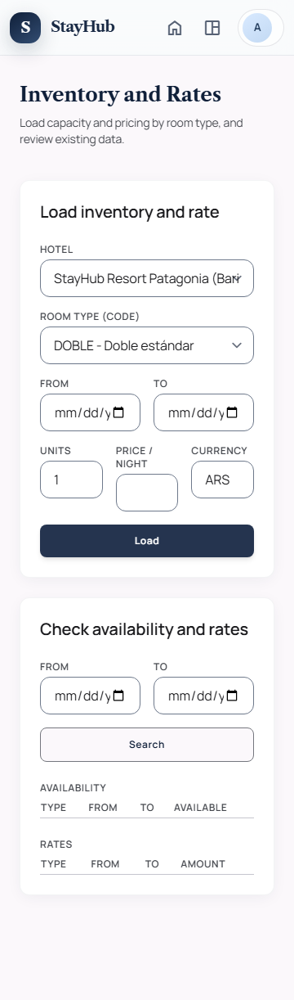
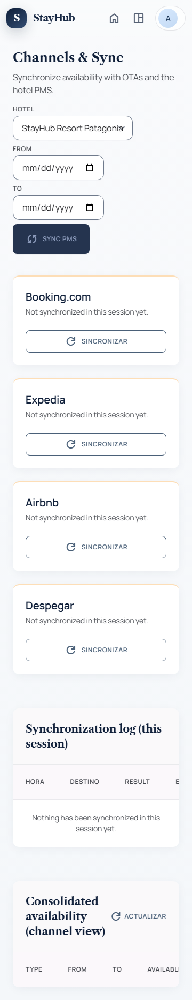
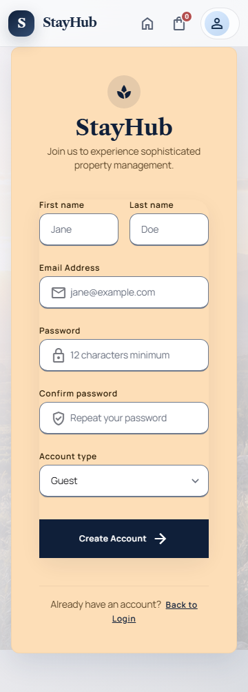
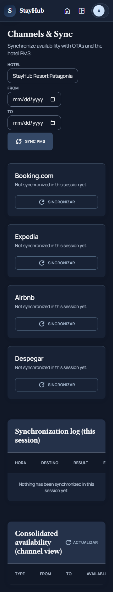
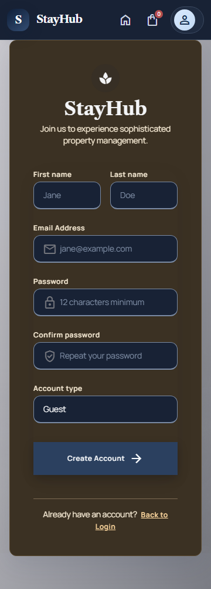
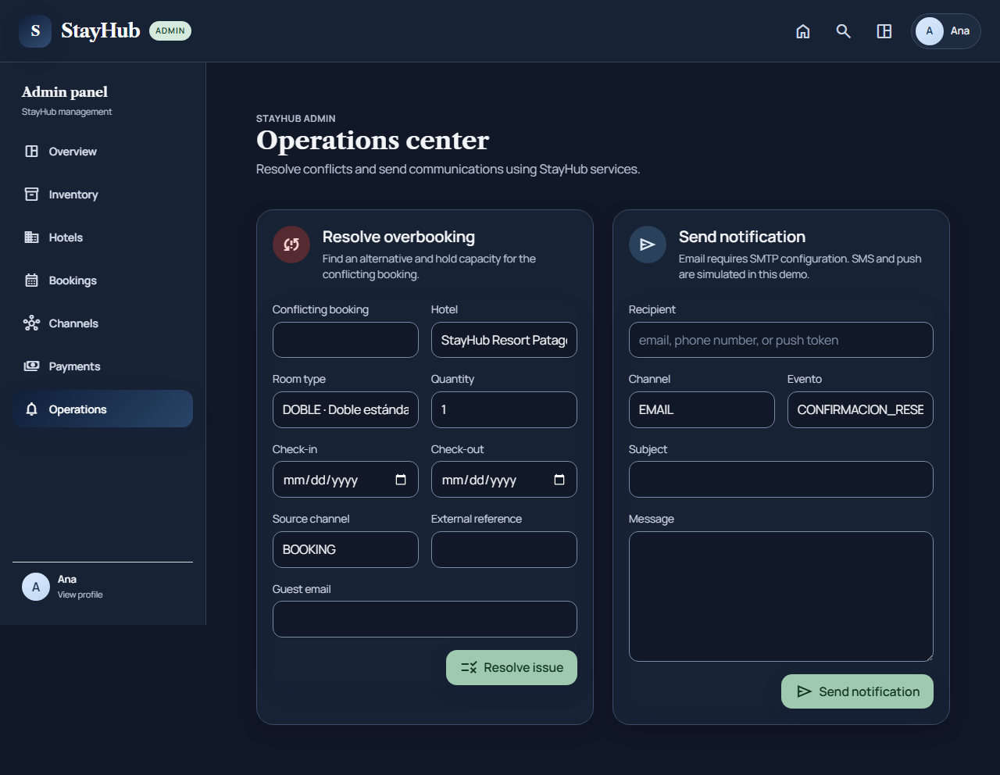

# Responsive y accesibilidad WCAG 2.2 AA (Eje A)

Evidencia para el Eje A de los Criterios de Testing (Clase 15, sección 4): responsive verificado a 360, 768 y 1280 px, accesibilidad con Lighthouse/axe ≥ 90 y sin violaciones críticas (WCAG 2.2 AA).

## Estado

| Criterio de aceptación | Estado |
|---|---|
| Se prueban 360, 768 y 1280 px | Cumplido: 19 pantallas × 3 anchos, en tema claro y oscuro |
| Lighthouse/axe obtiene 90 o más | Cumplido: Lighthouse 100 en las 76 mediciones (19 pantallas × móvil y escritorio × tema claro y oscuro) |
| No existen violaciones críticas | Cumplido: 0 críticas y 0 graves (la prueba exige más que lo pedido) |
| Se adjuntan reportes y evidencias | Cumplido: artefacto de CI y capturas de este documento |
| Run de CI con el job `ui-accesibilidad` en verde | **Pendiente** hasta el primer push (link abajo) |

Link al run en verde: _pendiente_

## Qué se automatizó

El paquete [ui-accesibilidad](../ui-accesibilidad/README.md) corre en el job `ui-accesibilidad` de [.github/workflows/security.yml](../.github/workflows/security.yml), en cada push y PR. Son 209 pruebas de Playwright más 76 mediciones de Lighthouse:

| Instrumento | Pruebas | Qué comprueba |
|---|---|---|
| Playwright + @axe-core/playwright 4.14 | 114 (19 pantallas × 3 anchos × 2 temas) | Reglas WCAG 2.0, 2.1 y 2.2 de nivel A y AA. Falla ante cualquier violación crítica o grave, desborde horizontal, meta viewport que bloquee el zoom, error de JavaScript, o si el tema pedido no quedó aplicado |
| Navegación por teclado | 57 (19 pantallas × 1280 claro, 360 claro, 1280 oscuro) | Recorre la página con Tab. Todo control enfocado cambia su aspecto (foco visible, WCAG 2.4.7), el encabezado fijo no lo tapa (foco no oculto, WCAG 2.4.11, criterio nuevo de 2.2) y no hay trampas de teclado (2.1.2) |
| Contraste de campos de formulario | 38 (19 pantallas × 2 temas, a 1280 px) | El límite de cada campo (borde o fondo) contrasta al menos 3:1 con su entorno (WCAG 1.4.11). axe no mide este criterio |
| Lighthouse 13 (categoría Accesibilidad) | 76 mediciones | Móvil (360 px) y escritorio (1280 px) por pantalla y tema. Falla si alguna queda por debajo de 90 |

**Pantallas cubiertas (19):** inicio, ingreso, registro, recuperar y restablecer contraseña, detalle de hotel, carrito, pago, detalle de reserva, configuración, nosotros, ayuda, panel de administración, inventario, hoteles, canales, pagos, operaciones y portal de personal.

**Cómo corre sin Docker:** el arnés `servidor-mock.mjs` sirve las pantallas reales, simula la API con datos de la forma de los DTO del backend y fija el usuario en `sessionStorage` según el rol de cada pantalla. Se activa `prefers-reduced-motion`, porque las animaciones de entrada dejan elementos semitransparentes y falsean la medición de contraste.

**Las pruebas se verificaron contra sus propios falsos verdes:** cada una falló antes de corregir el código (ver resultados) y se hicieron controles negativos. Por ejemplo, agrandar el encabezado fijo a 780 px hace fallar la prueba de "foco no oculto", y un tema que no se aplica hace fallar la verificación del tema. También se repitió la suite 3 veces seguidas con idéntico resultado (0 pruebas inestables).

## Resultados (2026-11-02)

| Medición | Antes de corregir | Después |
|---|---|---|
| Playwright + axe en tema claro (57) | 45 pasan, 12 fallan | **57 pasan** |
| Playwright + axe en tema oscuro | 56 combinaciones de contraste incumplidas | **57 pasan** |
| Teclado (57) | 10 fallan (campos de fecha sin foco visible) | **57 pasan**: 875 controles enfocados, 0 sin indicador, 0 tapados, 0 trampas |
| Contraste de campos (38) | 23 fallan | **38 pasan**: 96 campos medidos, mínimo 3,37:1 |
| Lighthouse (76 mediciones) | mínimo 99 | **mínimo 100, promedio 100** |
| Pantallas con desborde horizontal | 7 combinaciones | **0** |

Las 209 pruebas tardan 1 min 20 s en local y las 76 mediciones de Lighthouse unos 4 min 30 s con 4 procesos.

## Defectos encontrados y corregidos

Los encontró la propia automatización y quedaron corregidos. Conviene registrarlos en Jira y en el registro de defectos de QA.

| # | Severidad | Pantallas | Defecto | Corrección |
|---|---|---|---|---|
| 1 | Mayor | Inventario, hoteles, canales, operaciones (360 px) | En pantallas de hasta 820 px la barra lateral se oculta, pero el contenido conservaba su margen izquierdo de 264 px: la regla de rediseño de `theme.css` se declaraba después de la regla responsive y la pisaba. Los formularios se salían de la pantalla | Regla responsive repetida después del rediseño ([theme.css](../proyecto/src/main/webapp/assets/css/theme.css)) |
| 2 | Mayor | Portal de personal (768 y 1280 px) | Margen izquierdo de 256 px (`md:ml-64`) pensado para una barra lateral que el shell común oculta: el contenido se salía 256 px | Se quitó el margen ([staff-portal.html](../proyecto/src/main/webapp/staff-portal.html)) |
| 3 | Mayor | Inicio (los 3 anchos) | El chip de canal activo mostraba texto gris sobre fondo `#0f1f39`: contraste 2,86:1, mínimo 4,5:1 (WCAG 1.4.3) | Texto blanco en el chip activo |
| 4 | Mayor | Canales (768 px), pagos (360 px) | Tablas y listas con scroll propio sin acceso por teclado (WCAG 2.1.1) | `tabindex="0"`, `role="region"` y nombre en cada región ([channels-sync.html](../proyecto/src/main/webapp/channels-sync.html), [payments.html](../proyecto/src/main/webapp/payments.html)) |
| 5 | Mayor | Las 17 pantallas con tema oscuro | **El tema oscuro incumplía el contraste de texto (WCAG 1.4.3) en todas**: 56 combinaciones distintas, entre 1 y 18 elementos por pantalla. El bloque de rediseño aplicaba fondos blancos translúcidos (encabezado, filtros, tarjetas de vidrio, píldora de perfil), las clases de Tailwind con opacidad no estaban cubiertas por las reglas oscuras, y la barra lateral de administración mostraba textos casi invisibles (1,09:1) | Bloque de correcciones del tema oscuro al final de `theme.css` |
| 6 | Mayor | Todas las pantallas con campos | **El límite de los campos de formulario no llegaba a 3:1** (WCAG 1.4.11): 1,4:1 en claro y hasta 1,0:1 en oscuro, donde algunos campos conservaban el borde del tema claro | Borde `#6f7a8c` en claro y `#7a8aa3` en oscuro para todo campo con borde. El selector de hotel del panel no tenía borde: se le agregó |
| 7 | Menor | Campos de fecha (inicio, inventario, canales, operaciones) | Sin borde ni sombra, el único indicador de foco era el segmento interno del navegador (mes, día o año) | Contorno de 2 px en todo el campo, claro y oscuro |
| 8 | Menor | Registro (360 px) | Desborde de 16 px: `w-full` más márgenes laterales en un contenedor de bloque | `w-auto` ([register.html](../proyecto/src/main/webapp/register.html)) |
| 9 | Mayor | Todas las pantallas con encabezado | El vínculo del carrito tenía el nombre accesible "Cart", pero su texto visible incluía el contador (WCAG 2.5.3, *Label in Name*, nivel A). Lighthouse lo marcaba sin peso en el puntaje y axe 4.14 lo promovió a violación grave en 60 de las 114 pruebas | El nombre accesible incluye siempre la cantidad, también cuando es 0: "Cart, 0 items", "Cart, 2 items" ([api.js](../proyecto/src/main/webapp/assets/js/api.js)) |
| 10 | Menor | Portal de personal | Tres fotos con el nombre de la persona repetido al lado (`image-redundant-alt`) | `alt=""` |

### Evidencia visual (tema claro)

| Inventario a 360 px | Canales a 360 px | Registro a 360 px |
|---|---|---|
|  |  |  |

[Portal de personal a 1280 px](img/responsive/staff-portal-1280-claro.png) y [panel de administración a 768 px](img/responsive/admin-dashboard-768-claro.png).

### Evidencia visual (tema oscuro)

| Canales a 360 px | Registro a 360 px | Operaciones a 1280 px |
|---|---|---|
|  |  |  |

[Portal de personal a 1280 px, tema oscuro](img/responsive/staff-portal-1280-oscuro.png). El set completo (axe, teclado, contraste de campos, capturas y reportes de Lighthouse) queda en el artefacto de CI.

## Dependencias de las pruebas

El escaneo OSV del CI (job `Dependencias y SBOM`) falló con el primer `package-lock.json` del paquete: 12 vulnerabilidades conocidas (4 altas), todas heredadas de dependencias de desarrollo de Lighthouse 12. Se resolvió así:

- Lighthouse 13.6.0, `chrome-launcher` 1.2.2 y `@axe-core/playwright` 4.14.0 (la versión 13 ya no arrastra `puppeteer-core`, `extract-zip` ni `zod`; pasó de 30 a 5 vulnerabilidades en `npm audit`).
- `overrides` en [ui-accesibilidad/package.json](../ui-accesibilidad/package.json) para `minimatch` (^11.0.1) y `glob` (^14.0.3), que son dependencias internas de una herramienta de empaquetado de Sentry dentro de Lighthouse y no se ejecutan en estas pruebas. Se pueden quitar cuando Lighthouse publique una versión con las suyas ya corregidas.
- Resultado: `npm audit` sin vulnerabilidades y OSV-Scanner 2.7.0 (el mismo que usa el CI) con "No issues found" sobre todos los lockfiles. Con el lockfile anterior, la misma herramienta daba 12 vulnerabilidades y salía con error.

## Limitaciones

- **API simulada.** El arnés usa datos de ejemplo, no el stack real. Se cubre el marcado y los estilos de cada pantalla, pero no estados que dependen del backend (mensajes de error, listas largas, estados vacíos) ni ventanas modales abiertas.
- **Automatización no reemplaza revisión manual.** Las herramientas automáticas solo detectan una parte de los problemas de accesibilidad WCAG. No se hizo una prueba con lector de pantalla ni un recorrido manual completo del orden lógico de lectura.
- **Alcance de las pruebas propias.** El contraste de componentes (1.4.11) se mide solo en campos de formulario, no en botones, íconos ni estados de foco. El foco visible se detecta como cambio de estilo al enfocar, no por contraste del indicador (2.4.13 es nivel AAA, fuera del alcance). El tema oscuro se prueba a 1280 px en teclado y contraste de campos, y en los tres anchos con axe.
- **Responsive = sin desborde horizontal.** Se verifica que nada se salga del ancho y que el zoom no esté bloqueado. La calidad visual del diseño en cada ancho se revisó solo en las capturas.
- **Lighthouse sin latencia.** Se ejecuta sin limitación de red sobre un servidor local, porque solo se usa la categoría de accesibilidad.
- **Buscador de la portada.** Los campos de destino y de fechas no tienen borde propio: forman un conjunto dentro de una barra con su propio contenedor, y se excluyen de la medición de 1.4.11.
- **Tests y correcciones con IA.** La suite y las correcciones las generó Claude. Quien presente debe poder explicarlas (Eje E, declaración G8).

## Para la defensa

- El docente puede pedir correr `npm run verificar` en `ui-accesibilidad/` (requiere Node 22 y `npx playwright install chromium`).
- Cada pantalla, ancho y tema deja un JSON de axe y una captura: sirven para mostrar el resultado de cualquier combinación.
- Lecciones aprendidas (entregable 8): cuatro de estos defectos (el margen de la barra lateral, el contraste del chip, las regiones con scroll y el tema oscuro completo) llegaron a la rama de desarrollo porque no había ninguna prueba de UI en varios anchos ni de accesibilidad. Esta suite los habría atrapado en el PR que los introdujo.
- Un error propio que conviene contar: la primera versión de las pruebas de tema oscuro corría en realidad en tema claro (el servidor de pruebas pisaba el tema), y las capturas en oscuro salían idénticas a las claras. Se detectó al comparar tamaños de archivo y se agregó una verificación del tema aplicado en cada prueba.
