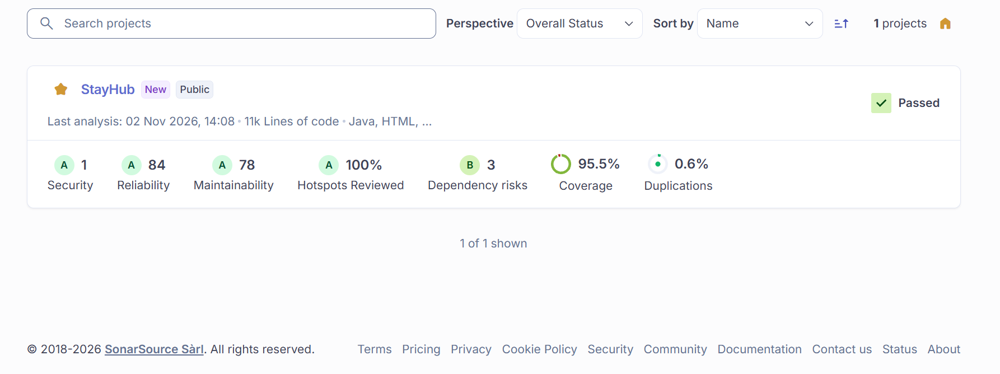

# Análisis estático con SonarCloud y Quality Gate (Eje B)

Evidencia para el Eje B de los Criterios de Testing (Clase 15, sección 5): Quality Gate aprobado, 0 bugs Blocker/Critical, 0 vulnerabilidades, duplicación ≤ 3%, ratings A en confiabilidad y seguridad, 100% de security hotspots revisados.

## Estado

| Parte | Estado |
|---|---|
| Integración en el repositorio (pom, CI, script del gate) | Hecha |
| Código corregido hasta cumplir los criterios | Hecho, validado con SonarQube local (ver resultados) |
| Cuenta, organización y proyecto en SonarCloud, secreto y variables de GitHub | Hecho (organización `stayhub`, proyecto `stayhub_stayhub`, secreto `SONAR_TOKEN`, variables `SONAR_ORGANIZATION` y `SONAR_PROJECT_KEY`) |
| Análisis en CI | Hecho: el PR #77 publicó el análisis en SonarCloud (0 bugs, 0 vulnerabilidades, ratings A, duplicación 0,6%, 0 hotspots) |
| Quality Gate propio "StayHub TP" asociado al proyecto | Hecho en SonarCloud (5 condiciones sobre el código completo). El análisis del PR #77 es anterior y se evaluó con *Sonar way*; los análisis siguientes usan "StayHub TP" |
| Análisis de `development` | Hecho: Quality Gate **StayHub TP** aprobado con valores reales |
| Análisis de `main` | **Pendiente**: se publica al mergear `development` a `main` (ver "Rama principal") |

## Qué se agregó al repositorio

| Elemento | Detalle |
|---|---|
| [proyecto/pom.xml](../proyecto/pom.xml) | Propiedades `sonar.*`: fuentes (`src/main/java` y `src/main/webapp`), exclusión del CSS generado por Tailwind y de librerías de terceros, ruta del XML de JaCoCo y alcance de cobertura (el mismo que JaCoCo, ver [COBERTURA_JACOCO.md](COBERTURA_JACOCO.md)). La organización, la clave del proyecto y el token **no** están en el repo |
| [.github/workflows/security.yml](../.github/workflows/security.yml), job `backend` | `fetch-depth: 0`; paso de análisis con `sonar.qualitygate.wait=true`, que **hace fallar el pipeline si el Quality Gate no pasa**; resumen del gate en el job; `quality-gate.json` y `report-task.txt` en el artefacto `backend-evidence` (carpeta `sonar-evidence/`). Si faltan el secreto o las variables, el análisis se omite con una advertencia visible (no rompe el CI antes de configurar) |
| [sonar/crear-quality-gate.sh](../sonar/crear-quality-gate.sh) | Crea el gate **StayHub TP** por API, repetible, y lo asocia al proyecto |

### Quality Gate "StayHub TP"

Evalúa el **código completo**, no solo el nuevo (los gates nuevos vienen sembrados con condiciones de código nuevo; el script las elimina):

| Condición | Falla si |
|---|---|
| `reliability_rating` | Peor que A (A implica 0 bugs, así que 0 Blocker/Critical) |
| `security_rating` | Peor que A |
| `vulnerabilities` | Mayor que 0 |
| `duplicated_lines_density` | Mayor que 3% |
| `security_hotspots_reviewed` | Menor que 100% |

## Pasos para configurarlo en SonarCloud (los hace una persona del equipo)

1. Entrar a https://sonarcloud.io con la cuenta de GitHub, importar la organización y el repositorio **StayHub**.
2. En el proyecto: **Administration > Analysis Method**, desactivar *Automatic Analysis* (el análisis lo hace el CI).
3. En SonarCloud, **My Account > Security**, generar un token.
4. En GitHub, **Settings > Secrets and variables > Actions**:
   - Secreto `SONAR_TOKEN` con ese token.
   - Variables `SONAR_ORGANIZATION` (la clave de la organización) y `SONAR_PROJECT_KEY` (la clave del proyecto).
5. Crear el gate y asociarlo al proyecto (el script resuelve la diferencia de API: SonarCloud identifica los gates por id y SonarQube por nombre):
   ```
   SONAR_TOKEN=... SONAR_HOST_URL=https://sonarcloud.io \
   SONAR_ORGANIZATION=<org> SONAR_PROJECT_KEY=<proyecto> ./sonar/crear-quality-gate.sh
   ```
   Si el plan de SonarCloud no permite gates propios, dejar *Sonar way* y verificar a mano en el dashboard que se cumplan los criterios de la tabla de arriba (los resultados locales indican que se cumplen).
6. Hacer push y revisar que el job `backend` pase. Pegar abajo el link al run y la captura del dashboard (la cátedra pide la captura del Quality Gate en el informe de ejecución).

Link al run en verde (PR #77): https://github.com/chiara-p581/StayHub/actions/runs/41143152544
Link al dashboard de SonarCloud: https://sonarcloud.io/project/overview?id=stayhub_stayhub (organización `stayhub`, clave `stayhub_stayhub`)

## Rama principal en SonarCloud

El proyecto se creó con la rama principal llamada `master`, que no existe en este repositorio. Decisión del equipo: que el dashboard por defecto muestre **`development`**. En SonarCloud: **Administration > Branches and Pull Requests**, renombrar la rama principal de `master` a `development`. Hacerlo antes del primer análisis de esa rama.

El workflow analiza los pushes a `development` y a `main`, y el proyecto es público, así que SonarCloud conserva ambas ramas. La cátedra evalúa el tag `v1.0-testing`, que va sobre `main` (G2):

- Antes de la prueba, abrir el selector de ramas del dashboard y comprobar que `main` aparece con el Quality Gate aprobado.
- Un tag no tiene nombre de rama, así que el workflow analiza los runs sobre un tag con `-Dsonar.branch.name=main` (el tag `v1.0-testing` apunta a `main`). Esto no se pudo probar sin un tag real: verificarlo en el primer run sobre el tag y dejar margen antes de las 13:30 del 10/11 por si hay que corregirlo.

## Evidencia: captura del dashboard (rama `development`, 2026-11-02 14:08)



Qué muestra y cómo leerla:

- **Passed**: el Quality Gate "StayHub TP" está aprobado.
- **Security A, Reliability A, Hotspots Reviewed 100%, Duplications 0,6%**: cumplen los criterios de la cátedra. Los ratings A del gate coinciden con la API: `reliability_rating` y `security_rating` valen 1 (A), con 0 bugs y 0 vulnerabilidades.
- **Los números junto a los ratings** (Security 1, Reliability 84, Maintainability 78) son la cantidad de issues abiertos por calidad de software. Se verificó por API que **ninguno tiene impacto alto ni blocker**: los 84 de Reliability son *code smells* de impacto medio, y el 1 de Security es de impacto bajo (S1313, una IP fija en `ConfiguracionCanales`, que es la lista de hosts bloqueados contra SSRF). La cátedra pide 0 bugs Blocker/Critical y 0 vulnerabilidades, no 0 issues.
- **Coverage 95,5%**: medida sobre el alcance de negocio configurado (ver [COBERTURA_JACOCO.md](COBERTURA_JACOCO.md)), no sobre todo el código.
- **Dependency risks B (3)**: es el análisis de composición de software (SCA) de SonarCloud y no forma parte del Quality Gate de esta tarea. Conviene revisar esos 3 riesgos antes de cerrar el informe de seguridad, que exige 0 CVE críticas o altas sin mitigación documentada.

Esta captura es de la lista de proyectos de la organización. Para el informe de ejecución conviene sumar otra de la pantalla **Overview** del proyecto, que muestra el nombre de la rama y las condiciones del gate una por una. Repetir las capturas sobre `main` después del merge.

## Resultados de la validación local (2026-10-30)

No pude usar SonarCloud, así que validé con SonarQube Community Build 26.9 en local, con el mismo motor de análisis y el perfil *Sonar way* de Java, JavaScript, CSS y HTML/JSP. **SonarCloud puede reportar reglas distintas o adicionales** (su versión de las reglas puede diferir), por eso el primer run real puede traer hallazgos nuevos que habrá que revisar.

| Métrica | Primer análisis | Después de corregir | Criterio |
|---|---|---|---|
| Bugs | 23 | **0** | 0 Blocker/Critical |
| Vulnerabilidades | 6 | **0** | 0 |
| Rating de confiabilidad | D | **A** | A |
| Rating de seguridad | C | **A** | A |
| Duplicación | 0,6% | **0,6%** | ≤ 3% |
| Security hotspots | 0 | **0** | 100% revisados (no hay hotspots que revisar) |
| Mantenibilidad | A | A | n/a |
| Cobertura (alcance de negocio) | 95,5% | 95,5% | n/a |

Quality Gate **StayHub TP**: pasa (`BUILD SUCCESS`). Cuando un gate falla, el análisis con `sonar.qualitygate.wait=true` termina en `BUILD FAILURE`: se vio en una corrida intermedia, en la que el gate tenía una condición de código nuevo que no se cumplía. Es lo que hará fallar el CI.

### Correcciones hechas

**Java de producción**

| Regla | Dónde | Corrección |
|---|---|---|
| S2654 (Critical): `synchronized` en un EJB | `ServicioDeReservasImpl` (3 métodos de canal) | Se mantiene la exclusión por referencia con un `ReentrantLock` por ranura, en lugar de `synchronized` |
| S2119 (Critical): `Random` nuevo en cada llamada | `TokenRecuperacion` | `SecureRandom` estático reutilizado |
| S2445: sincronizar sobre un parámetro | `Csrf.token` | Candado estático propio |
| S2259: posible NPE | `ConfiguracionCanales.esLocal` | Comparaciones seguras ante null, sin cambiar el resultado |
| S2077 (4 vulnerabilidades): consulta JPQL armada por concatenación | `HotelRepositoryJpa` | Dos consultas literales completas. Nunca había entrada del usuario en la concatenación: era un falso positivo, pero se reescribió para eliminarlo |

**Hallazgos del primer análisis real en SonarCloud (rama `development`, 2026-11-02):** el Quality Gate falló solo por el rating de confiabilidad (C, 2 bugs). Eran reglas nuevas que el SonarQube local no tenía, tal como se había advertido. Todo lo demás cumplía.

| Regla | Dónde | Corrección |
|---|---|---|
| `java:S9436`: dos loggers en la misma clase | `AuditoriaSeguridad` | Sonar sugiere unificarlos, pero `stayhub.security.audit` y `stayhub.error` son categorías distintas con archivos distintos en WildFly ([seguridad-a-logging.cli](../config/seguridad-a-logging.cli)). Unificarlas rompería el ruteo de logs. El logger de errores pasó a una clase interna `CanalErrores`, con el mismo nombre de categoría |
| `javascript:S9383`: promesa sin esperar ni marcar como ignorada | `inventory-1.js` (`refrescarTipos` en el evento `change`) | `void refrescarTipos(...)`. La función ya captura sus errores con `.catch` |

Tras la corrección, el Quality Gate de `development` pasó con valores reales: confiabilidad A, seguridad A, 0 vulnerabilidades, duplicación 0,6%, 100% de hotspots revisados (0 bugs, cobertura 95,5% en el alcance configurado).

**Tests**: S9351 (2 bugs) en `CarritoDeReservaTest` y `ServicioDeReservasCanalTest`: `BigDecimal.equals` reemplazado por `compareTo`.

**Frontend** (sin cambios de diseño): 10 inputs sin label asociado (se agregaron `for` a labels existentes o `aria-label`), `index.jsp` sin `DOCTYPE`, `title` ni `lang`, dos fuentes CSS sin familia genérica y dos usos de `Math.random` (S2245) reemplazados por `crypto.getRandomValues`.

Verificación tras los cambios: 666 tests en verde, JaCoCo y PIT en verde (PIT 99%), tests del frontend 24/24.

## Limitaciones y puntos a revisar

- **Code smells:** quedan 445 (304 Major, 37 Critical, 52 Minor, 52 Info). La cátedra no los incluye en el gate. Conviene mirar los 37 Critical (suelen ser complejidad cognitiva) por si preguntan.
- **El análisis cubre `proyecto/`** (backend Java y frontend web). No cubre `pms-legado-mock` ni los scripts de `contracts/`.
- **`aria-label` como label:** el análisis local lo aceptó para la regla `InputWithoutLabelCheck`. Si SonarCloud lo marcara, cambiar esos 4 inputs a un `<label for>` oculto visualmente.
- **Hotspots:** hoy no hay ninguno. Si SonarCloud abre alguno, hay que revisarlo y marcarlo (seguro o corregido) desde el dashboard antes de la prueba: sin eso falla la condición de 100% revisados.
- **Tests y código generados con IA:** parte de estas correcciones las hizo Claude. Quien presente debe poder explicarlas (Eje E, declaración G8).
