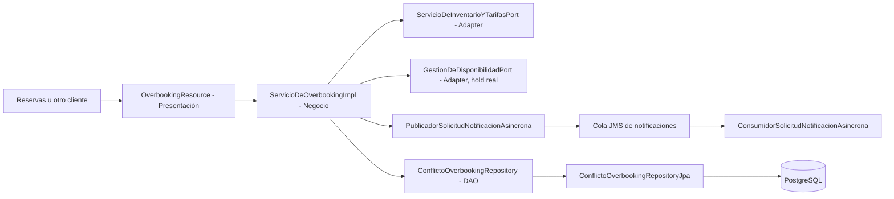

# ServicioDeOverbooking

Componente Jakarta EE `@Stateless` que resuelve conflictos cuando una reserva confirmada no se
puede cumplir (overbooking real: se vendió más de lo que hay disponible). Busca una alternativa en
el mismo hotel y período, intenta retenerla con un hold real antes de darla por resuelta, y si no
hay alternativa disponible, resuelve por compensación.

## Alcance

- Resolver un conflicto de overbooking recibido para una reserva, un hotel y un período.
- Buscar un tipo de habitación alternativo con cupo suficiente en el mismo hotel y fechas.
- Retener esa alternativa con un hold real (reutilizando el mismo mecanismo de
  `ServicioDeInventarioYTarifas` que usa `ServicioDeReservas`) antes de confirmar la reubicación,
  para no "prometer" una habitación que otra solicitud podría tomar mientras tanto.
- Si no hay alternativa, o si el hold falla porque otra solicitud se adelantó, resolver por
  compensación en vez de reubicación.
- Registrar el conflicto y su resolución, y publicar una solicitud JMS de notificación por email
  cuando el conflicto incluye un destinatario.

**Nota honesta:** el enum `EstrategiaResolucion` define una tercera estrategia,
`CANCELACION_ANTICIPADA`, que hoy no está implementada en `resolverConflicto` — la lógica actual
solo aplica `REUBICACION` o `COMPENSACION`. Queda declarada para una posible extensión futura.

## Arquitectura en capas

| Capa | Paquetes y clases principales | Responsabilidad |
| --- | --- | --- |
| Presentación | `api/OverbookingResource`, `OverbookingExceptionMapper` | Adaptar HTTP/JSON y códigos de estado |
| Negocio | `service/ServicioDeOverbookingImpl`, `contrato/ServicioDeOverbooking`, `contrato/interno/ServicioDeInventarioYTarifasPort` | Resolución del conflicto y orquestación entre componentes |
| Datos | `repository/ConflictoOverbookingRepository`, `ConflictoOverbookingRepositoryJpa`, `model/ConflictoOverbooking`, `EstrategiaResolucion` | Persistencia JPA y modelo del dominio |



## Patrones aplicados

### DAO / Repository

`ConflictoOverbookingRepository` separa la persistencia del conflicto de la lógica que decide cómo
resolverlo, resuelto con JPA por `ConflictoOverbookingRepositoryJpa`.

### Adapter

`ServicioDeInventarioYTarifasPort` y `GestionDeDisponibilidadPort` (este último, el mismo puerto que
usa `ServicioDeReservas`) desacoplan a Overbooking de la implementación concreta de Inventario y
Tarifas. El componente depende de una interfaz propia, no de la clase de otro equipo.

### Dependencias y mensajería

Las dependencias de Inventario (`ServicioDeInventarioYTarifasPort` y
`GestionDeDisponibilidadPort`) se inyectan como `Instance<T>` y se comprueba `isResolvable()` antes
de usarlas. Si Inventario y Tarifas no está disponible, Overbooking responde con
`DEPENDENCIA_NO_DISPONIBLE`. La resolución y persistencia ocurren dentro de la llamada HTTP; después
se publica la notificación en JMS para que su entrega no bloquee la respuesta.

La operación no modifica la reserva original ni libera el hold que esa reserva ya tuviera. Tampoco
se ejecuta automáticamente desde Reservas: un administrador debe informar el conflicto mediante el
endpoint. `CANCELACION_ANTICIPADA` sigue declarada, pero no está implementada.

## API REST

Con el WAR `StayHub.war`, la URL base predeterminada es:

```text
https://localhost:8080/StayHub/api/overbooking
```

| Método | Ruta | Resultado |
| --- | --- | --- |
| `POST` | `/overbooking/resolver` | Resuelve un conflicto de overbooking (reubicación o compensación) |

## PostgreSQL

Comparte la unidad de persistencia `StayHubPU` y el datasource `java:/PostgresDS` con el resto de
los componentes.
